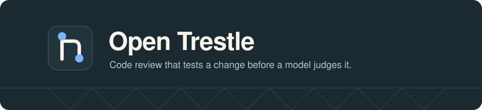
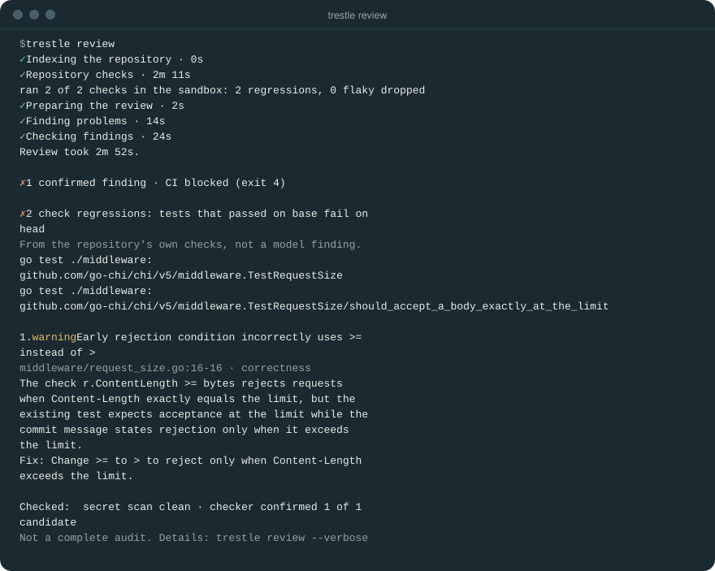
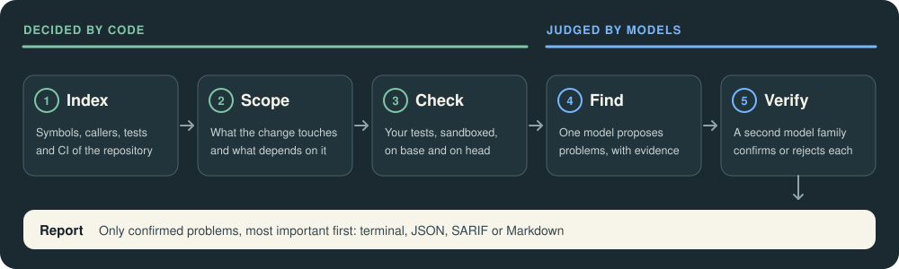

<p align="center">
  
</p>

<p align="center">
  <a href="https://github.com/georgejieh/open-trestle/actions/workflows/verify-runtime.yml"></a>
  <a href="https://github.com/georgejieh/open-trestle/releases"></a>
  <a href="LICENSE"></a>
  <a href="go.mod"></a>
  <a href="docs/platforms.md"></a>
</p>

<p align="center">
  <a href="#install"></a>
  <a href="docs/getting-started.md"></a>
  <a href="docs/commands.md"></a>
  <a href="docs/README.md"></a>
</p>

Open Trestle is an open-source agent harness built for one job: reviewing
code. It is a complete runtime of its own, with its own repository index,
sandbox, model routing, secret scanning and spending limits, and every part of
it is tuned for review.

It indexes the repository, works out what a change touches, runs the
repository's own tests on the change in a sandbox, and only then asks a model
to look for problems. A second model, from a different family, checks every
problem before you see it.

It runs in your terminal, in CI and in VS Code, with the model providers you
choose, including models on your own hardware.

<p align="center">
  
</p>

## Install

Linux (amd64):

```sh
curl -fsSL https://georgejieh.dev/open-trestle/install.sh | bash
```

Windows (amd64), in PowerShell:

```powershell
irm https://georgejieh.dev/open-trestle/install.ps1 | iex
```

Then, in the Git repository you want reviewed, with your changes committed on
a branch:

```sh
trestle init      # guided setup: where the two models run, and an API key if needed
trestle review    # review your branch against the default branch
trestle           # home screen: setup, spending and the last review
```

The current releases are unsigned pre-releases. [Install](docs/install.md)
says what the scripts do and how to build from source, and
[getting started](docs/getting-started.md) follows a first review from start
to finish.

## How a review runs

<p align="center">
  
</p>

1. **Index.** Open Trestle reads the repository: its symbols, who calls what,
   its tests and its CI configuration.
2. **Scope.** It works out what the change touches and what depends on that
   code, and reads what the change says it is for.
3. **Check.** With your consent, it runs the repository's own tests on the
   base commit and on your change, in a sandbox with no network. A test that
   passed before and fails now is reported as a fact, not an opinion.
4. **Find.** One model looks for problems, with the changed code, its callers
   and the test results in front of it.
5. **Verify.** A second model checks each problem against the source and
   rejects what it cannot confirm.

The [design rationale](docs/rationale.md) explains the order and why the
second model should come from another family.

## What you get

| | |
| --- | --- |
| 🧪 **Tested before judged** | The repository's tests run on base and head before any model call. See [repository checks](docs/repository-checks.md). |
| 🔁 **Two model families** | One model proposes, another verifies. Only confirmed problems are reported, ranked, with duplicates merged. |
| 🧭 **Scope and leftovers** | A review compares the change with what it says it does and with the project's own intent documents, and points out unrequested scope and leftover code. See [specialist profiles](docs/agent-profiles.md). |
| 📌 **Proof you can run** | With `--model-checks`, the verifier writes a test for a confirmed problem. It is kept only if it passes on base and fails on your change. |
| 🔌 **Your models** | OpenRouter, Ollama Cloud and OpenCode Go, or a local server: Ollama, llama.cpp, vLLM, LM Studio and other OpenAI-compatible servers. |
| 🔒 **Private by default** | Every remote request is scanned for secrets twice before it is sent. No telemetry. See [privacy](docs/privacy.md). |
| 💸 **Spending limits** | Set a limit per API key. Open Trestle warns as you approach it and stops at it. See [spending limits](docs/spending-limits.md). |
| 📄 **Output for people and tools** | Text in the terminal, or JSON, SARIF and Markdown. See [review output](docs/local-model-review.md). |
| 🧩 **Where you work** | [VS Code](docs/vscode.md) shows findings in the Problems panel, and a [GitHub Actions example](examples/github-actions/README.md) reviews each pull request. |

## Languages

Open Trestle reads source at the level of its syntax tree for:

`Go` `Python` `JavaScript` `TypeScript` `Java` `C` `C++` `C#` `Rust` `Swift` `PHP` `Ruby` `HTML`

Go also gets value-level tracking of where a variable, constant or function is
used. Repository checks run Go, Python and Node.js test suites. See
[syntax analysis](docs/syntax-analysis.md).

## Status

Open Trestle is in pre-release on Linux and Windows (amd64). macOS builds but
is not supported; see [platforms](docs/platforms.md).

Not built yet:

- A signed release. The install scripts download unsigned pre-releases, and a
  checksum shows only that a download matches the release.
- A desktop app.
- Syntax analysis for game-engine languages.

The [roadmap](docs/roadmap.md) lists what is next, and the
[changelog](CHANGELOG.md) lists what changed.

## Documentation

| | |
| --- | --- |
| [Getting started](docs/getting-started.md) | Setup and a first review |
| [Commands](docs/commands.md) | Every command and flag |
| [Review output](docs/local-model-review.md) | Results, ranking and specialists |
| [Troubleshooting](docs/troubleshooting.md) | What each message means; start with `trestle doctor` |
| [All pages](docs/README.md) | The full index, grouped by task |

## Contributing

Contributions are welcome. Read [CONTRIBUTING.md](CONTRIBUTING.md) before
opening a pull request, and report security problems privately as described in
[SECURITY.md](SECURITY.md).

## License

[Apache License 2.0](LICENSE) · attribution in [NOTICE](NOTICE)
